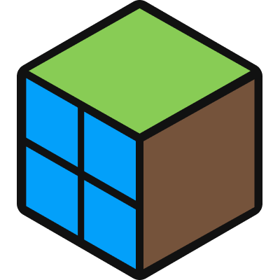
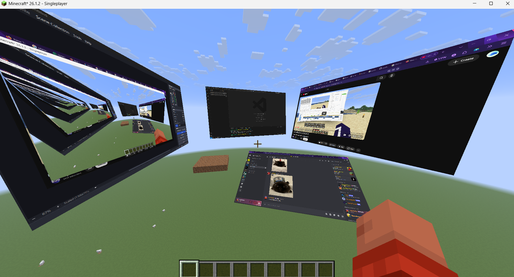

<p align="center">
  
</p>

<h1 align="center">Windows in Minecraft</h1>

<p align="center">
  <b>Interact with your Windows desktop, directly inside of your Minecraft world. No limits.</b>
</p>

<p align="center">
  
  
  
</p>

---

## § Overview

**Windows in Minecraft** is an experimental mod that brings your actual desktop operating system straight into the Minecraft rendering pipeline. Instead of 2D overlays or blocks with displays, this project lets you spawn, move, resize, and interact with real desktop windows directly inside the 3D world.

**_HEAVILY_** inspired by [waylandcraft](https://github.com/EVV1E/waylandcraft) and [Bog's video](https://www.youtube.com/watch?v=_JyqwPXNeG4&) on that mod, this project instead targets the Windows ecosystem using native graphics capture (WGC) and DXGI pipelines via a C++ bridge.



---

## ◈ Features

- **Interactive 3D Panels:** Spawn desktop window panels anywhere in your world.
- **Direct Mouse Input:** Click, drag, and resize floating windows directly in-game.
- **Native Window Pipeline:** Built around low-latency native window capture rather than slow, pixel-by-pixel screen grabbing.
- **Targets Fabric 26.1.2:** Built for a stable and modern Minecraft version. Future versions may be coming sooner or later.

---

## ▽ Setup & Download

Look to the side, find a section named `Releases`, and click the latest release. Then just download the latest jar file (NOT `...-sources.jar`), add it into your `mods/` folder where you have Fabric and Minecraft installed, and go right ahead!

It is V to open the window spawning menu, and X to close a menu that you have open. There are also gazillion other quirks regarding how windows and input focus, and i consider that quite broken, so consider the current versions and this repo overall as a crappy "proof of concept" made in two evenings with opencode, to say the least.

---

## ◇ Roadmap

- [x] Basic 3D panel rendering & test canvas
- [x] Mouse raycasting, window dragging, and resizing
- [x] **Native App Capture:** Streaming live Windows apps (Notepad, browser, Spotify) via JNI & WGC
- [ ] Window management (border dragging, rotation, global UI)
- [ ] Modrinth / CurseForge releases

---

## ⬡ Building & Setup

### Prerequisites

- **JDK 25** (Gradle and your IDE must point to `JAVA_HOME` set to JDK 25)
- `MSVC` and `CMake` (for native C++ bridge compilation)

### Building & Running

1. Clone the repository:
   ```bash
   git clone [https://github.com/your-username/windows-in-](https://github.com/your-username/windows-in-)
   ```
2. Test the mod with `./gradlew runClient` or build it with `./gradlew build`

### Toolchain Stack

| Component     | Version               | Configuration Location                     |
| ------------- | --------------------- | ------------------------------------------ |
| Minecraft     | 26.1.2 (unobfuscated) | `gradle.properties` (`minecraft_version`)  |
| Fabric Loader | 0.19.5                | `gradle.properties` (`loader_version`)     |
| Fabric API    | 0.155.3+26.1.2        | `gradle.properties` (`fabric_api_version`) |
| Fabric Loom   | 1.18-SNAPSHOT         | `gradle.properties` (`loom_version`)       |
| Java          | 25                    | `build.gradle` (`release = 25`)            |

---

## ¶ License

Read `LICENSE` (GPLv3)
